# 🚀 Awesome-Conversational-Support-ITSM

<p align="center">
  
</p>

<p align="center">
  <a href="https://github.com/ishandutta2007/Awesome-Awesome-Awesome"></a>
  <a href="https://discord.gg/jc4xtF58Ve"></a>
  <a href="https://github.com/ishandutta2007/Awesome-Conversational-Support-ITSM/stargazers"></a>
  <a href="https://github.com/ishandutta2007/Awesome-Conversational-Support-ITSM/network/members"></a>
  <a href="https://github.com/ishandutta2007/Awesome-Conversational-Support-ITSM/blob/main/LICENSE"></a>
  <a href="https://github.com/ishandutta2007"></a>
</p>

---

<p align="center">
  <strong>Curated Directory of Enterprise SaaS Solutions &amp; Open-Source Projects for Conversational Support &amp; ITSM</strong><br>
  <em>Explore AI Service Desks, Slack-First Ticketing Bots, Agent Assist Co-Pilots, and Self-Hosted Helpdesk Automation.</em>
</p>

<p align="center">
  <strong>🌟 Star if you find this repository valuable! 🌟</strong><br>
  <em>Last updated: November 2026</em>
</p>

---

## 📌 Executive Overview

This repository is an SEO-optimized, production-focused guide tracking commercial **SaaS platforms** and self-hosted **open-source repositories** in the **Conversational Support & ITSM (IT Service Management)** ecosystem. 

Modern conversational ITSM platforms empower employees and customers to resolve incidents, provision accesses, query knowledge bases, and submit service tickets directly within collaborative communication channels like **Slack**, **Microsoft Teams**, WhatsApp, and Web Chat. By combining autonomous **LLM reasoning agents** for routine tier-1 deflection with seamless **human-in-the-loop (HITL)** escalations, organizations slash resolution times while retaining full control over support telemetry and compliance.

### 🎯 Key Focus Areas
- 🤖 **Agentic Resolution**: Autonomous multi-step IT workflow execution (e.g., password resets, software provisioning, VPN diagnostics).
- 💬 **Slack-First & Teams-First Ticketing**: Frictionless conversational interfaces converting chat threads into structured service requests.
- 🧠 **Retrieval-Augmented Generation (RAG) Helpdesks**: Grounded question answering over internal runbooks, Confluence, SharePoint, and historical ticket memory.
- 🔒 **Data Sovereignty & Self-Hosted Solutions**: Full ownership over sensitive employee PII and LLM inference providers.

---

## 📑 Table of Contents

- [📊 Sector Overview & Market Dynamics](#-sector-overview--market-dynamics)
- [🏢 SaaS & Hosted Platforms](#-saashosted-platforms)
- [💻 Open-Source GitHub Projects](#-open-source-github-projects)
  - [⭐ Open-Source Ranking by Stars](#-open-source-ranking-by-stars)
  - [🔍 Deep-Dives into Key Repositories](#-deep-dives-into-key-repositories)
  - [🛠️ Architectural Blueprints for Custom Stacks](#️-architectural-blueprints-for-custom-stacks)
- [🤝 How to Contribute](#-how-to-contribute)
- [💖 Support & Sponsorship](#-support--sponsorship)
- [📈 Star History](#-star-history)
- [⚠️ Disclaimer](#️-disclaimer)

---

## 📊 Sector Overview & Market Dynamics

The global conversational AI and IT support automation market is estimated at **$14B–$19B** and projected to surpass **$75B–$115B+** by the mid-2030s, expanding at a rapid **21%–25%+ CAGR**.

The sector exhibits a **hybrid competitive structure**:
- 🏛️ **Concentrated at the Platform Layer**: Heavily dominated by hyperscalers (Microsoft, AWS, GCP) providing foundational LLM infrastructure, alongside legacy enterprise ITSM titans (ServiceNow, Atlassian, Zendesk, Salesforce) that embed native agentic copilots directly into their core databases and workflows.
- 🧩 **Moderately Fragmented at the Application Layer**: Niche agentic startups (e.g., Moveworks, Forethought, Ada) and composable open-source frameworks (Dify, Chatwoot, Langfuse, GLPI) compete aggressively to deliver multi-system orchestration, customized domain RAG, and vendor-neutral data sovereignty.

---

## 🏢 SaaS & Hosted Platforms

The following benchmark compares leading commercial conversational support and ITSM platforms, sorted descending by **Company Size (Market Capitalization / Valuation / ARR)**. Every entry specifies transparent entry-level pricing tiers, exact trial conditions, and core architectural trade-offs.

| 🏢 Company / Product | 📈 Company Size (Valuation / Revenue) | 🏷️ Starting Tier Pricing | 🎁 Free Tier / Trial Limits | 🚀 Key Capabilities & Best For | ⚖️ Architectural Trade-offs |
| :--- | :--- | :--- | :--- | :--- | :--- |
| **[Atlassian Assist](https://www.atlassian.com/software/jira/service-management)** (JSM) | **$53B market cap** (~$5.22B FY25 revenue) | **$20/agent/month** (Standard) or **$51.42/agent/month** (Premium) billed annually | **Free for up to 3 agents** permanently with 2 GB storage; includes core incident request queues and unlimited portal customers (AI Assist features require Premium tier). | Slack-native service management for Jira Service Management. Employees react with `:ticket:` or `/assist` in Slack to create tickets; works across service spaces without full Jira licenses. | AI virtual agent requires Premium+ ($51.42+/mo); single Slack workspace per Jira site; no native two-way thread sync. |
| **[Zendesk AI](https://www.zendesk.com/)** | **$10.2B valuation** (Acquired by H&F/Permira; ~$1.34B+ ARR) | **$19/agent/month** billed annually (Support Team) or **$55/agent/month** (Suite Team) | **14-day free trial** with full access to Suite Professional features (no permanent free tier). | Built-in AI agents and agent assist within Zendesk Suite. Best for organizations wanting resolution-oriented automation natively inside their ticketing tool. | Outcome-based AI pricing ($1.50–$2.00 per automated resolution); Copilot is an additional $50/agent/mo; per-seat + per-resolution fees stack up. |
| **[Freshservice](https://www.freshworks.com/freshservice/)** | **$3.8B market cap** (~$839M FY25 revenue) | **$19/agent/month** billed annually (Starter) or **$49/agent/month** (Growth) | **21-day free trial** with full Enterprise-tier features (no permanent free tier). | Structured ITSM platform with incident management, asset tracking, and Freddy AI service desk automation. Best for mid-market IT teams. | Freddy AI sessions require a separate add-on (~$29–$35/agent/mo); managed assets are capped at 100 on the Growth tier. |
| **[Intercom](https://www.intercom.com/)** | **$3.6B acquisition valuation** (Salesforce; ~$400M ARR) | **$29/seat/month** billed annually (Essential) | **14-day free trial** (expandable by 7 days upon request) with full platform features, Fin AI Agent, and Copilot; no credit card required. | AI-first conversational platform with Fin AI Agent and modern helpdesk. Best for teams wanting integrated customer support with AI automation. | Outcome-based billing charges $0.99 per resolved conversation on top of seat licenses; advanced capabilities require higher tiers. |
| **[Moveworks](https://www.moveworks.com/)** | **$2.85B acquisition valuation** (ServiceNow; ~$100M+ ARR) | **$150/user/year** (AWS Marketplace entry for 1,000–2,500 employees; ~$150K/year baseline contract) | **No self-serve free tier or public trial**; proof of concepts (POCs) and sandbox pilots are sales-negotiated for enterprise scoping. | Autonomous agentic AI for enterprise employee support across IT, HR, and finance with deep action resolution via Slack/Teams. | High enterprise entry barrier (six-figure annual minimum commitment); being integrated into ServiceNow enterprise packaging. |
| **[Aisera](https://aisera.com/)** | **~$257M ARR** (Acquired by Automation Anywhere; $150M+ raised) | **$200,000/year** (AWS Marketplace entry tier for up to 1,000 users; ~$108K/yr median contract) | **30-day trial for up to 50 users** via AWS Marketplace private listing (no self-serve free plan). | Deep IT and HR service desk domain configuration with multi-LLM orchestration. | Heavy implementation setup fees (often 50%–100% of Year-1 license); post-acquisition roadmap changes. |
| **[Ada](https://www.ada.cx/)** | **$1.2B valuation** (~$70M+ ARR) | **$33,000/year** (AWS Marketplace entry tier for 60,000 conversations; ~$60K/yr typical starting plan) | **No self-serve free plan or public trial**; guided proof of concept (PoC) available only via enterprise sales qualification. | Agentic customer experience platform with deep workflow actions and reasoning engines across omnichannel support. | High annual entry price; requires sales consultation and substantial implementation commitment ($15K–$100K+). |
| **[Yellow.ai](https://yellow.ai/)** | **$550M valuation** (Public listing via SPAC / $350M+ raised) | **$0/month** (Free tier) or **Custom enterprise quotes** for scaled dynamic AI | **Free forever plan** includes 5,000 monthly bot sessions, 500 chat/email tickets/month, unlimited agent seats, 2 channels, and 1,000 WhatsApp conversations/mo. | Omnichannel enterprise conversational AI supporting both customer engagement and internal employee IT desks. | Freemium tier excludes advanced analytics, Doc Cog, Voice, and SMS channels. |
| **[Capacity](https://www.capacity.com/)** | **$100M+ ARR** ($159M+ venture funding raised) | **$25,000/year** (~$2,083/month baseline annual platform fee for Core tier) | **No public free tier or self-serve trial**; custom guided proof-of-concept (POC) sandbox environments provided after sales scoping. | AI support platform combining helpdesk ticketing, knowledge automation, and agent assist without separate LLM token bills. | Platform fee plus volume-based AI usage fees require careful capacity and cost modeling; no instant onboarding. |
| **[Forethought](https://forethought.ai/)** | **Acquired by Zendesk** ($115M+ raised; Zendesk's largest acquisition) | **$50/agent/month** (Assist) + **$0.50–$2.00/conversation** (Solve) | **No self-serve trial or free tier**; enterprise Proof of Value (POV) simulations run against historical ticket datasets. | Agentic AI workflow suite (Solve, Triage, Assist) purpose-built for ticket routing, agent assistance, and autonomous resolution. | Requires high historical volume (20,000+ tickets); implementation packages range from $10,000–$50,000+. |

---

## 💻 Open-Source GitHub Projects

Open-source conversational ITSM and support software gives engineering teams full data sovereignty, zero per-ticket license fees, and the ability to customize LLM reasoning engines.

Below is a curated collection of active open-source projects ranging from purpose-built RAG IT agents and comprehensive service desks to conversational inboxes and AI orchestration engines.

### ⭐ Open-Source Ranking by Stars

Every repository is ranked below in **descending order by GitHub stargazers**, featuring real-time Stars_Badges linking directly to each repo's stargazers community:

| 📦 Repository | ⭐ GitHub_Stars | 📜 License | 🎯 Primary Category | 💡 Architectural Purpose in Conversational Support & ITSM |
| :--- | :--- | :--- | :--- | :--- |
| **[Dify](https://github.com/langgenius/dify)** | <a href="https://github.com/langgenius/dify/stargazers"></a> | Apache-2.0 | LLM Application & Agent Orchestration | Visual prompt orchestration, RAG pipelines, and conversational agent workflows with built-in Slack, Teams, and Webhook integrations. |
| **[Novu](https://github.com/novuhq/novu)** | <a href="https://github.com/novuhq/novu/stargazers"></a> | MIT | Unified Notification Infrastructure | Critical routing layer for dispatching conversational ticket alerts, SLA escalations, and incident notifications across Slack, SMS, Email, and Teams. |
| **[Chatwoot](https://github.com/chatwoot/chatwoot)** | <a href="https://github.com/chatwoot/chatwoot/stargazers"></a> | MIT | Omnichannel Support Inbox & Live Chat | Shared team inbox with live chat widget, email, WhatsApp, and social channel management with native bot handoff to human support engineers. |
| **[Langfuse](https://github.com/langfuse/langfuse)** | <a href="https://github.com/langfuse/langfuse/stargazers"></a> | MIT | LLM Observability & Evaluation | Production monitoring, latency tracking, cost analytics, and prompt evaluation for conversational ITSM agents and RAG pipelines. |
| **[Rasa](https://github.com/RasaHQ/rasa)** | <a href="https://github.com/RasaHQ/rasa/stargazers"></a> | Apache-2.0 | Enterprise Conversational AI & NLU | Deterministic dialogue management, natural language understanding (NLU), and enterprise chatbot frameworks connecting frontends to backend IT queues. |
| **[Botpress](https://github.com/botpress/botpress)** | <a href="https://github.com/botpress/botpress/stargazers"></a> | AGPL-3.0 | Conversational Bot Builder & Flows | Developer platform for creating modular conversational bots, intent classifications, and webhook triggers for internal helpdesks. |
| **[GLPI](https://github.com/glpi-project/glpi)** | <a href="https://github.com/glpi-project/glpi/stargazers"></a> | GPL-3.0 | Complete Open-Source ITSM & Asset CMDB | Mature ITIL-compliant service desk managing incidents, changes, problems, and IT assets; pairs with conversational frontends via REST API. |
| **[Papercups](https://github.com/papercups-io/papercups)** | <a href="https://github.com/papercups-io/papercups/stargazers"></a> | MIT | Open-Source Live Customer Messaging | Built-in two-way Slack sync allowing support agents to reply directly from internal Slack channels to end-user web chat tickets. |
| **[Zammad](https://github.com/zammad/zammad)** | <a href="https://github.com/zammad/zammad/stargazers"></a> | AGPL-3.0 | Enterprise Helpdesk & Support Ticketing | Modern web-based helpdesk platform supporting omni-channel tickets, SLA management, and customizable webhooks for bot integration. |
| **[FreeScout](https://github.com/freescout-helpdesk/freescout)** | <a href="https://github.com/freescout-helpdesk/freescout/stargazers"></a> | AGPL-3.0 | Lightweight Helpdesk & Shared Inbox | Self-hosted PHP/Laravel alternative to Zendesk/Help Scout with extensive community module support for chat and automated workflows. |
| **[osTicket](https://github.com/osTicket/osTicket)** | <a href="https://github.com/osTicket/osTicket/stargazers"></a> | GPL-2.0 | Traditional Open-Source Ticket System | Battle-tested ticket routing and web portal infrastructure; serves as a reliable backend for custom conversational wrappers. |
| **[helpdesk-agentico](https://github.com/dfserver1/helpdesk-agentico)** | <a href="https://github.com/dfserver1/helpdesk-agentico/stargazers"></a> | MIT (Per repo) | Purpose-Built RAG IT Support Agent | Specialized RAG support agent for IT featuring self-learning resolution memory (`MemoryIngest`/`MemoryRecall`) and human-in-the-loop (`ChatDecide`) approval. |

---

### 🔍 Deep-Dives into Key Repositories

#### 1. [helpdesk-agentico](https://github.com/dfserver1/helpdesk-agentico) — *Specialized RAG IT Agent with HITL Verification*
- **Overview**: The only open-source project engineered specifically for conversational IT service desks with built-in ticket drafting and memory recall.
- **Core Features**:
  - **Self-Learning Resolution Memory**: Endpoints (`MemoryIngest`/`MemoryRecall`) index resolved tickets and runbooks into vector memory to answer future inquiries automatically.
  - **Human-in-the-Loop (HITL) Validation**: The agent creates structured ticket drafts that require explicit administrative approval (`ChatDecide`) before committing changes to production databases.
  - **Enterprise Connectors**: Native connectors (`ConnectorsSearch`) for SharePoint, Teams, Outlook, and web documentation.
  - **Tech Stack**: FastAPI (Python), Streamlit, Google Gemini API, JWT authentication.
- **Trade-offs**: Early-stage repository with Spanish documentation and no out-of-the-box agent inbox UI.

#### 2. [Chatwoot](https://github.com/chatwoot/chatwoot) — *Omnichannel Support Inbox Foundation*
- **Overview**: A modern, self-hosted customer engagement suite that functions as the ideal conversational front-end for internal IT service desks.
- **Core Features**:
  - Live chat widgets, shared email team inboxes, and bidirectional connectors for Slack, WhatsApp, and Telegram.
  - Native bot handoff mechanics that transition automated conversational sessions to live human support agents.
  - Comprehensive REST APIs and webhooks for dispatching events to external LLMs and ITSM backends.
- **Trade-offs**: Lacks native ITIL workflows (incident/change management, CMDB asset tracking, and SLA escalation).

#### 3. [GLPI](https://github.com/glpi-project/glpi) — *ITIL-Compliant ITSM & CMDB Backbone*
- **Overview**: A mature, full-featured open-source IT service management solution managing asset inventories, license lifecycles, and ITIL-structured service desks.
- **Core Features**:
  - Full support for Incident, Problem, Change, and Release Management.
  - Comprehensive Asset Management / CMDB database tracking hardware, software, and user assignments.
  - Robust REST API enabling conversational frontends (e.g., Slack bots) to query ticket statuses and trigger automated ticket creations.
- **Trade-offs**: Traditional web interface requiring custom middleware or integration engines to power conversational chat experiences.

#### 4. [Dify](https://github.com/langgenius/dify) — *Visual Agentic Workflow Engine*
- **Overview**: An open-source LLM application development platform that simplifies orchestrating multi-agent systems, RAG pipelines, and conversational tools.
- **Core Features**:
  - Visual drag-and-drop workflow canvas for designing deterministic and agentic resolution paths.
  - Ready-to-use connectors for vector databases, external tool APIs, and team messaging channels.
  - Built-in prompt management, dataset chunking, and model-agnostic LLM provider switching.
- **Trade-offs**: General-purpose AI orchestration requiring deliberate configuration to enforce ITSM ticket lifecycle rules.

---

### 🛠️ Architectural Blueprints for Custom Stacks

For organizations looking to deploy an enterprise-grade, privacy-first conversational ITSM stack entirely on self-hosted infrastructure:

```
[ Slack / Microsoft Teams / Web Chat ]
                  │
                  ▼
   [ Omnichannel Layer: Chatwoot / Papercups ]
                  │
                  ▼
 [ AI Reasoning & RAG Layer: Dify / helpdesk-agentico / Rasa ]
         │                                    │
         ▼                                    ▼
[ Observability: Langfuse ]        [ ITIL Engine & CMDB: GLPI / Zammad ]
```

1. **Frontend Channel Layer**: Deploy **Chatwoot** or **Papercups** to aggregate incoming conversations from Slack, Teams, and web portals.
2. **Reasoning & Execution Layer**: Pipe messages into **Dify** or **helpdesk-agentico** to run vector search across IT knowledge bases and execute automated diagnosis scripts.
3. **Observability & Guardrails**: Connect **Langfuse** to track token expenditures, monitor prompt latency, and log conversational resolution accuracy.
4. **ITSM System of Record**: Record all approved incidents, changes, and user asset updates into **GLPI** or **Zammad** via secure REST webhooks.

---

## 🤝 How to Contribute

We welcome community contributions! To suggest new tools, update pricing tiers, or refine open-source entries:

1. **Fork the Repository**: Click the `Fork` button at the top right of this page.
2. **Create a Feature Branch**: `git checkout -b feat/add-new-itsm-tool`.
3. **Update Documentation**: Add your tool adhering to the existing tabular format (include link, license/pricing, free tier limits, and realistic trade-offs).
4. **Submit a Pull Request**: Provide a clear summary of what you added and why it benefits the conversational support ecosystem.

---

## 💖 Support & Sponsorship

If this curated guide helps your organization navigate conversational support, evaluate ITSM vendors, or architect self-hosted AI service desks:

- ⭐ **Star this repository** to help others discover it on GitHub.
- 🍴 **Fork and share** with your DevOps, IT operations, and engineering peers.
- ☕ **Support future development**: Buy us a coffee or sponsor ongoing research directly through the [GitHub Sponsors Dashboard](https://github.com/sponsors/ishandutta2007)!

---

## 📈 Star History

[](https://star-history.dera.page/#ishandutta2007/Awesome-Conversational-Support-ITSM&type=date&legend=top-left)

---

## ⚠️ Disclaimer

- This list is **community-curated** for architectural research, operational benchmarking, and informational purposes; it does not constitute an endorsement.
- **Data Governance & Compliance**: Conversational support systems routinely process employee PII, credentials, and sensitive internal logs. Ensure self-hosted or hosted implementations comply with SOC2, GDPR, HIPAA, and internal security guardrails before granting access to production endpoints.
- **Architectural Scope**: Carefully distinguish between **Slack-First Ticketing** (e.g., Atlassian Assist), **AI Support Suites** (Zendesk AI, Intercom, Freshservice), **Autonomous Enterprise Agentic Desks** (Moveworks, Aisera), and **Support Inboxes** (Chatwoot). Select architectures that match your desired level of autonomous execution vs. ticket management.
- **Pricing Opacity**: Commercial SaaS vendor pricing changes frequently; always verify final enterprise volume quotes directly with software providers.

---

<p align="center">
  <strong>Built with care for IT Service Managers, DevOps Engineers, and AI Architects.</strong><br>
  <em>Let's make Conversational Support &amp; ITSM more open, transparent, and resolution-focused.</em>
</p>
